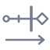
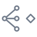
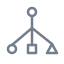

# Consequence

Architectural specifications, invariants, models, patterns, anti-patterns, and arguments for governing consequential systems.

## Invariants

| Geometry | Title | Tagline | Description |
| :---: | --- | --- | --- |
|  | [Constitutive Continuity](invariants/constitutive-continuity/README.md) | Change preserves independently specified constitutive relationships. | Requires admissible transformations and complete material lineage to preserve the kernel underlying a continuity claim. |
|  | [Constitutive Authority Closure](invariants/constitutive-authority-closure/README.md) | Authority and actual consequence remain connected. | Requires authentic governing meaning, current standing, conforming execution, complete effect control, and faithful evidence for each protected commitment. |
|  | [Structural Standing](invariants/structural-standing/README.md) | Eligibility must be necessary for consequence. | Requires every enabled protected effect to depend on actual eligibility and sufficient decision support across all covered routes. |
|  | [Temporal Standing](invariants/temporal-standing/README.md) | Standing must hold when consequence commits. | Requires exact semantic binding and current standing at effect commitment, with enforced ordering of relevant changes. |
|  | [Topological Zero](invariants/topological-zero/README.md) | Zero unmediated paths to protected consequence. | Requires every covered route to a protected effect to cross independently governed enforcement; authorized effects may remain reachable. |
|  | [Structural Zero](invariants/structural-zero/README.md) | The specified consequence is unreachable. | Establishes that no covered continuation can produce a specified effect within the declared scope, horizon, and assumptions. |

## Models

| Geometry | Title | Tagline | Description |
| :---: | --- | --- | --- |
|  | [Generative Root Geometry](models/generative-root-geometry/README.md) | Differentiation without severance. | Specifies how structures differentiate and transform while preserving verifiable relationships to their generative origin. |
|  | [Governing Root Geometry](models/governing-root-geometry/README.md) | Governing meaning requires independently established authority. | Defines domain semantics, effect obligations, delegation, applicability, and amendment rules under explicit constitutive trust assumptions. |
|  | [Constraint Geometry](models/constraint-geometry/README.md) | Geometry defines admissible behavior. Enforcement makes it binding. | Specifies immutable executable state, transition, constraint, objective, and effect semantics with independent authority boundaries. |
|  | [Constraint-Governed Agency](models/constraint-governed-agency/README.md) | The field provides possibility. Geometry shapes behavior. Standing governs consequence. | Models agents as versioned configurations of generative capability, with independently enforced authority over their effects and transformations. |
|  | [Semantic Time](models/semantic-time/README.md) | Locate computation within a lineage of meaning. | Resolves computation to immutable semantic versions and causal relationships, separating historical meaning from current execution authority. |
|  | [Recursive Geometry Evolution](models/recursive-geometry-evolution/README.md) | Geometry may propose its own evolution. It cannot authorize its own promotion. | Models recursive self-modification through immutable candidates, verified continuity, and independently authorized promotion. |
|  | [Semantic-Temporal Agent Geometry](models/semantic-temporal-agent-geometry/README.md) | Persistent identity. Exact geometry. Governed evolution. | Integrates semantic identity, temporary execution, linked geometry and transaction histories, and independently governed recursive evolution. |

## Patterns

| Geometry | Title | Tagline | Description |
| :---: | --- | --- | --- |
|  | [Verified Closure Flywheel](patterns/verified-closure-flywheel/README.md) | AI searches. Verification admits. Closure compounds. | Uses traces, model checking, and verified structural changes to reduce invalid reachability while preserving legitimate behavior. |

## Anti-Patterns

| Geometry | Title | Tagline | Description |
| :---: | --- | --- | --- |
|  | [Boolean Standing Fallacy](anti-patterns/Boolean-Standing-Fallacy.md) | A Boolean can assert authority. It cannot constitute it. | Exposes the error of treating a computed approval or cryptographic receipt as sufficient proof of legitimate governing authority. |

## Arguments

| Geometry | Title | Tagline | Description |
| :---: | --- | --- | --- |
|  | [Constitutive Floor Proof Standard](arguments/constitutive-floor/README.md) | Claim only what the evidence establishes. | Defines proof obligations for necessary consequence contracts, from non-vacuous formation and scope-wide closure through implementation refinement and deployment assurance. |

## License

Copyright 2026 Beau Crawford.

- Documentation, formulas, diagrams, and original artwork: [CC BY 4.0](LICENSES/CC-BY-4.0.txt).
- Software source files and marked code examples or pseudocode: [Apache 2.0](LICENSES/Apache-2.0.txt).
- Third-party material retains its own license terms and notices.

See [Licensing](LICENSE.md) for scope and attribution guidance, and [NOTICE](NOTICE) for software attribution.

---

© 2026 Beau Crawford
