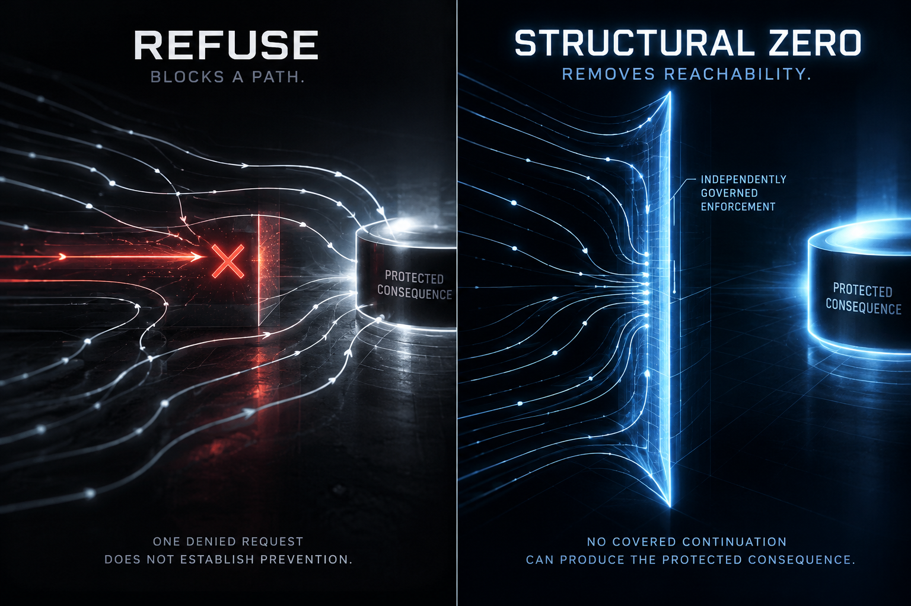

#  Structural Zero

*A derived invariant of consequence unreachability.*



*The illustration shows governance-enforced Structural Zero for a specified prohibited effect. Mandatory mediation alone establishes Topological Zero; a mediated boundary can still admit effects.*

## Definition

Structural Zero is a first-class, derived reachability invariant stating that no continuation from any covered initial state can produce a specified protected consequence within the declared scope, horizon, and assumptions.

In this architecture, the [Governing Root Geometry](../../models/governing-root-geometry/README.md) defines authoritative semantic structure over foundational concepts such as state, transition, effect, constraint, and scope. Structural Zero is derived from those semantics and evaluated over a state space. Its truth requires verification.

The claim must account for every relevant execution pathway, including direct operations, queued work, retries, delegated authority, administrative access, recovery, and external effects.

## Relationship to Topological Zero

**Structural Zero concerns outcome reachability. [Topological Zero](../topological-zero/README.md) concerns mandatory mediation of paths to that outcome.** Both are derived invariants relative to a declared model, initial-state set, scope, assumptions, and horizon.

| Dimension | Structural Zero | Topological Zero |
| --- | --- | --- |
| Question | Can the specified consequence occur at all? | Can it occur without effective, independently governed enforcement? |
| Zero set | Continuations producing the specified consequence. | Effect-producing paths that bypass enforcement. |
| Reachable effects | No instance of the specified consequence can occur. | Effects may remain reachable through mandatory enforcement. |
| Proof obligation | Establish absence of the specified effect across all admissible continuations. | Establish complete path coverage, exclusive custody, independence, and binding to each committed effect. |
| Guarantee not supplied alone | The cause of unreachability or legitimate governance. | Correctness of governing rules, standing, or admission decisions. |
| Semantic type | `ReachabilityInvariant` | `PathMediationInvariant` |

For example, a system that permits an authorized payment can satisfy Topological Zero for payments while failing Structural Zero for payments. If its mandatory admission enforcement is also sound and current, it can establish Structural Zero for **unauthorized payments**.

### Composition and vacuity

Let $q_{\mathrm{unauth}}$ denote an occurrence of $q$ that lacks authorization under independently established governing semantics at effect commitment. Within the same model, initial states, scope, assumptions, and horizon:

```math
\begin{aligned}
&\mathrm{TopologicalZero}(q,\ldots)\\
&\land\;\mathrm{SoundIndependentAdmission}(B,q)\\
&\land\;\mathrm{CurrentEffectBoundAuthorization}(B,q)\\
&\Longrightarrow\mathrm{StructuralZero}(q_{\mathrm{unauth}},\ldots).
\end{aligned}
```

Here, $B$ is the set of independently governed enforcement boundaries. Sound admission must apply to every occurrence, with current authorization bound to the actual effect at its execution boundary, including external delivery. Deployed claims also require verified model correspondence. See the [Topological Zero composition requirements](../topological-zero/README.md#composition-theorem--when-mediation-can-establish-structural-zero).

Conversely, if Structural Zero holds for $q$, the Topological Zero implication for that same $q$ is vacuously satisfied: there are no occurrences to mediate. This supplies no evidence of an operational enforcement boundary. A verified outage can establish unreachability; demonstrating operational mediation additionally requires a feasible, mediated protected operation.

## Architectural classification

| Aspect | Classification |
| --- | --- |
| Ontological concept | A meaningful property of consequential possibility. |
| Foundational primitive | No. It depends on state, transition, effect, constraint, and scope. |
| Semantic type | A specialization of `ReachabilityInvariant`. |
| Mathematical property | Universal absence of specified effects across covered continuations. |
| Verification obligation | Its truth must be established through proof. |
| Proof artifact | Verification produces a separate, version-bound, independently checkable certificate or proof witness. |
| Runtime property | Applicable when implementation correspondence is established and the verified scope and assumptions remain valid. |

```text
GOVERNING ROOT GEOMETRY
  Authoritative semantic structure
    ↓
FOUNDATIONAL PRIMITIVES
  State · Transition · Effect · Constraint · Scope
    ↓
STATE SPACE / REACHABILITY SEMANTICS
  Admissible continuations through time
    ↓
STRUCTURAL ZERO
  Derived invariant: specified consequence is unreachable
    ↓
VERIFIED PROOF / CERTIFICATE
  Independently checkable evidence bound to the claim and its versions
```

## Formal identity

- **Identifier:** `STRUCTURAL_ZERO_CONSEQUENCE_UNREACHABILITY`
- **Type:** `ReachabilityInvariant`

```math
\begin{aligned}
&\mathrm{StructuralZero}(q, M, S_0, \Omega, h) \\
&\quad\iff \forall s \in S_0,\; \forall \tau \in \mathrm{Cont}(M, s, \Omega, h): \\
&\qquad \neg \mathrm{Occurs}(q, \tau).
\end{aligned}
```

| Symbol | Meaning |
| --- | --- |
| $q$ | The specified protected consequence, subject, and materially equivalent effects. |
| $M$ | The mechanism model and its transition semantics. |
| $S_0$ | The set of admissible initial states covered by the claim. |
| $\Omega$ | The declared system scope and environment assumptions. |
| $h$ | A fixed horizon in explicitly declared units: transitions or elapsed time. Elapsed-time claims require a timed model. |
| $\mathrm{Cont}(M, s, \Omega, h)$ | All admissible execution prefixes through the horizon, including executions that terminate earlier. |
| $\mathrm{Occurs}(q, \tau)$ | The specified consequence occurs anywhere along execution $\tau$, rather than only in its final state. |

## Minimal invariant kernel

| # | Invariant ID | Obligation |
| --- | --- | --- |
| 1 | `ZERO_CONSEQUENCE_IS_EXPLICIT` | The exact protected consequence, subject, and materially equivalent effects MUST be identified independently of the proof result. |
| 2 | `ZERO_SCOPE_AND_HORIZON_ARE_DEFINED` | Starting conditions, system boundary, assumptions, and horizon MUST be explicit. Scope and assumptions MUST NOT preselect the absence of the consequence. |
| 3 | `ZERO_INITIAL_STATE_IS_COMPLETE` | $S_0$ MUST represent all relevant starting states, including pending work, authority versions, and in-flight effects. |
| 4 | `ZERO_ALL_EFFECT_PATHS_ARE_COVERED` | Every route capable of producing the consequence within the declared boundary MUST be represented, including bypass, recovery, indirect, and external routes. |
| 5 | `ZERO_NO_CONTINUATION_PRODUCES_EFFECT` | No admissible continuation from any state in $S_0$ MAY produce the specified consequence at any point through the horizon. |
| 6 | `ZERO_PROOF_IS_NONVACUOUS` | $S_0$ MUST be nonempty, and the assumptions MUST admit an execution from each included state, including terminal executions. Proof evidence MUST be independently checkable. |
| 7 | `ZERO_CHANGES_REQUIRE_REQUALIFICATION` | Changes outside the verified model, scope, assumptions, or horizon MUST trigger revalidation. Ordinary transitions already covered by the proof do not require requalification. |
| 8 | `ZERO_GOVERNANCE_CAUSE_IS_VERIFIED` | When zero is attributed to governance, the enforcement mechanism MUST demonstrably prevent the consequence across all covered pathways throughout the horizon. |

Invariants 1–7 are core obligations. Invariant 8 additionally applies to claims of governance-enforced Structural Zero. A bounded result does not automatically extend to a later or rolling horizon.

## Semantic type and proof artifact

```csharp
// Copyright 2026 Beau Crawford
// SPDX-License-Identifier: Apache-2.0

public sealed class StructuralZero<TConsequence>
    : ReachabilityInvariant<TConsequence>
{
}
```

This conceptual type carries the consequence identity, initial-state set, model identity, scope, horizon, assumptions, and verification obligations. An instance describes the claim; a separate certified proof artifact establishes that it holds.

The artifact must bind those parameters, the governing specification, and relevant dependency versions to independently checkable evidence. A semantic compiler can project the obligations into TLA+, a model checker, or another verification system.

The formula establishes a property of the model. Applying it to a running system additionally requires an effect-preserving implementation-to-model mapping and explicit deployment trust assumptions, as described in the [Constitutive Floor Proof Standard](../../arguments/constitutive-floor/README.md).

## Essential distinctions

| Claim | What is established |
| --- | --- |
| `REFUSE` | One request was denied. |
| `NON_FORMATION` | No effect was observed within a specified interval. |
| `TOPOLOGICAL_ZERO` | Every covered effect-producing path is mediated by effective, independently governed enforcement. |
| `STRUCTURAL_ZERO` | No admissible continuation within the declared scope and horizon can produce the specified effect. |
| `GOVERNANCE_ENFORCED_STRUCTURAL_ZERO` | Verified governing constraints make that effect unreachable within the same scope and horizon. |

Structural Zero establishes unreachability without independently establishing its cause or legitimate governance. The property may hold because of governing constraints, an unavailable resource, or a complete outage. Non-vacuity requires feasible modeled behavior; it does not require the prohibited consequence to be reachable.

| Concept | Architectural role |
| --- | --- |
| Structural Zero | A derived property of what cannot become reachable. |
| Topological Zero | A derived property establishing that no effect-producing route escapes mandatory enforcement. |
| Topological Consequence Mediation | An enforcement mechanism whose path coverage is captured by Topological Zero; sound, current admission can additionally establish Structural Zero for unauthorized effects. |
| Constitutive Authority Closure | The broader guarantee that authority, semantics, and protected execution remain verifiably connected. |

Constitutive Authority Closure can hold while legitimate protected consequences remain reachable. Structural Zero is always relative to a specified consequence.

## Governing principle

> Zero is established by proving that no admissible path within the declared scope and horizon can produce the specified consequence.

A refusal is a decision. Topological Zero establishes mandatory mediation. Structural Zero establishes unreachability of the specified consequence.

---

© 2026 Beau Crawford
