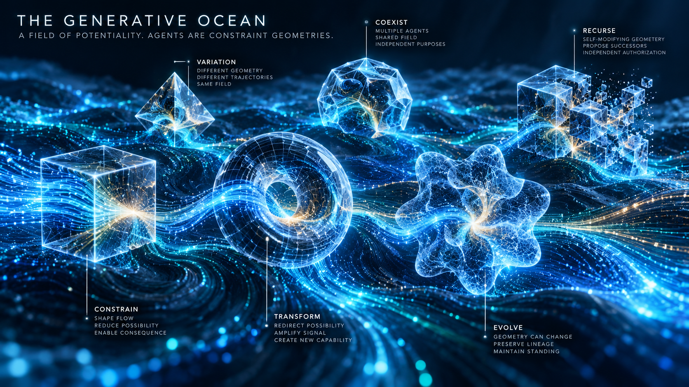

#  Constraint-Governed Agency

*An architectural model of reconfigurable generative capability with independently enforced authority over consequence.*

> **The field provides possibility. Geometry shapes behavior. Standing governs consequence.**



## Definition

**Constraint-Governed Agency (CGA)** is an architectural model in which an agent is a bounded, versioned configuration of generative capabilities, objectives, context, memory, and constraints. Its configuration shapes what it can perceive, propose, and attempt; independently governed execution mechanisms determine which protected consequences can actually occur.

An **agent geometry** is that configuration and its relevant structural relationships. Geometry may be instantiated, differentiated, composed, revised, or retired. Agents may be temporary or persistent; names, processes, and durable memory remain useful mechanisms, but none independently establishes identity continuity or authority.

**CGA is a model that requires invariants, not an invariant itself.** The name is proposed terminology for this architecture. A declaration that a system follows CGA does not establish that its enforcement obligations hold.

## The Generative Ocean

**The Generative Ocean** is the explanatory metaphor: available generative capabilities form a field of possibility, and agent geometries organize particular expressions of that possibility.

The field need not be literally continuous, universally shared, or supplied by one model. Its available behavior depends on actual models, computation, tools, resources, and environmental conditions. Changing geometry can change behavior and expose or combine capabilities; claims of improved or newly emerging capability require evaluation.

Objectives establish direction. Context shapes available information. Memory carries selected state across interactions. Constraints specify permitted behavior, while enforcement mechanisms make applicable restrictions effective. **A prompt that requests restraint is not equivalent to a mechanism that prevents an unauthorized effect.**

Retiring an agent does not erase its records or automatically cancel delegated credentials, background work, queued intents, or external operations. Its lifecycle must account for those continuing consequences.

## Architectural classification

| Aspect | Classification |
| --- | --- |
| Ontological concept | Agency as a configurable organization of generative capability and consequential access. |
| Architectural model | **Yes.** CGA describes how generation, configuration, governance, and execution relate. |
| Foundational primitive | No. It depends on state, capability, context, transition, effect, authority, and scope. |
| Invariant | **No.** Structural Standing, Temporal Standing, and their preservation through reconfiguration are required properties of an implementation. |
| Semantic type | `AgentArchitectureSpecification`, with separately stated conformance and preservation obligations. |
| Mathematical structure | A transition model whose states include agent geometries, resources, governing versions, and effect-producing mechanisms. |
| Verification obligation | Establish exact semantic binding, current standing at commitment, authoritative ordering, complete effect-route coverage, and preservation across configuration and environment changes. |
| Proof artifact | A version-bound, independently checkable conformance argument with supporting enforcement and transition evidence. |
| Runtime relevance | Guarantees apply only where the deployed mechanism corresponds to the verified model and its assumptions. |

```text
GENERATIVE SUBSTRATE
  Available models, computation, tools, and resources
    ↓ configured through
AGENT GEOMETRY
  Objectives · Context · Memory · Capabilities · Constraints
    ↓ produces
PROPOSED ACTION OR GEOMETRY CHANGE
    ↓ admitted under independently constituted governing rules
PROTECTED EXECUTION BOUNDARY
  Exact effect · Current standing · Required support
    ↓ commits
CONSEQUENCE AND DURABLE EVIDENCE
```

The sequence expresses responsibility, not a requirement for one centralized service. Every covered effect route must satisfy its applicable obligations. Tool calls, disclosures, memory writes, delegation, and configuration changes can themselves be protected effects; labeling them “reasoning” or “internal work” does not exempt them.

## Formal identity

- **Identifier:** `CONSTRAINT_GOVERNED_AGENCY`
- **Type:** `AgentArchitectureSpecification`
- **Explanatory metaphor:** `GENERATIVE_OCEAN`

A CGA specification can be represented as:

```math
\mathcal{A}=\langle F,\mathcal{G},L,M,\Omega\rangle
```

| Symbol | Meaning |
| --- | --- |
| $F$ | The available generative substrate and its material capability and resource dependencies. |
| $\mathcal{G}$ | The space of versioned agent geometries admitted or considered by the architecture. |
| $L$ | Independently constituted governing contracts, delegation rules, and authorized amendment semantics. |
| $M$ | The complete mechanism model, including generation, semantic binding, execution, reconfiguration, revocation, delegation, queues, local and external commitment boundaries, and authoritative ordering of material changes. |
| $\Omega$ | Declared initial states, protected-effect scope, governing applicability and effective-time rules, environment, timing, and failure assumptions, trust dependencies, and any claimed horizon. |

A configuration view of an agent geometry can be described by:

```math
G_{\mathrm{config}}=\langle O,X,\mu,U,P,B\rangle
```

| Symbol | Meaning |
| --- | --- |
| $O$ | Objectives and their priorities. |
| $X$ | Context construction, information access, and interpretation configuration. |
| $\mu$ | Memory schema, initialization, persistence, and migration rules. Actual memory and local-state values belong to an execution instance. |
| $U$ | Declared tool interfaces and requested capabilities. Actual grants require separate authority. |
| $P$ | Specified transition constraints, budgets, and behavioral policies. |
| $B$ | Bindings to governing contracts and execution boundaries; references do not authenticate themselves. |

[Constraint Geometry](../constraint-geometry/README.md) specifies the executable state, transition, constraint, and effect semantics of this configuration. Its immutable definition remains distinct from current inputs, context values, and operational state.

These tuples organize the specification; they do not prove enforcement or completeness. The mechanism state must bind actual model and geometry versions, executable artifacts, credentials, dependencies, and in-flight work. Any additional component that can materially affect a covered consequence belongs in the model.

## Required invariant kernel

The central safety obligation is an application of [Structural Standing](../../invariants/structural-standing/README.md) to a mechanism that includes evolving agent configurations. [Temporal Standing](../../invariants/temporal-standing/README.md) makes its semantic-binding, applicability, and commitment-ordering obligations explicit:

```math
\begin{aligned}
I(s)&\equiv\forall e\in\mathrm{Protected}(M,s):\\
&\quad\mathrm{Enabled}(e,s)\Rightarrow\mathrm{Standing}_{L}(e,s),\\
H_{\mathrm{CGA}}(M,\Omega)&\equiv\forall s\in\mathrm{Reach}(M,\Omega):I(s).
\end{aligned}
```

| Symbol | Meaning |
| --- | --- |
| $s$ | A mechanism state, including current governing facts and all relevant active geometry versions. |
| $e$ | An exact covered protected-effect transition, including its actor, target, parameters, and joint consequences. |
| $\mathrm{Protected}(M,s)$ | The covered protected-effect transitions considered from state $s$. |
| $\mathrm{Enabled}(e,s)$ | The actual mechanism can perform the transition, rather than merely returning an approval. |
| $\mathrm{Standing}_{L}(e,s)$ | Actual eligibility, applicable authority, and sufficient decision support hold for the exact transition under the governing contract applicable at its effect boundary. |
| $\mathrm{Reach}(M,\Omega)$ | All mechanism states reachable under the declared initial conditions, scope, assumptions, and horizon. |
| $I(s)$ | The local standing-enforcement condition. |
| $H_{\mathrm{CGA}}(M,\Omega)$ | The required preservation of that condition across the covered reachable mechanism. |

`Standing` denotes a substantive obligation, not an agent-supplied flag. Verification and enforcement must bind it to the actual transition at effect commitment. Successor-dependent conditions and aggregate resource constraints require checking the complete transition and its joint effects; the notation must not hide those requirements.

| Invariant ID | Required property |
| --- | --- |
| `CGA_PROTECTED_EFFECTS_REQUIRE_CURRENT_STANDING` | Every covered enabled effect MUST have current, independently established eligibility, authority, and required support. |
| `CGA_EXECUTION_BINDS_ONE_GEOMETRY` | Every admitted execution unit MUST bind exactly one immutable geometry version; composite interactions must identify their constituent units and bindings explicitly. |
| `CGA_TEMPORAL_STANDING_AT_COMMITMENT` | Every protected commitment MUST retain its exact applicable semantic binding and current standing under enforced ordering of relevant changes, including at external receivers. |
| `CGA_PROTECTED_EFFECT_ROUTES_ARE_MEDIATED` | No covered route MAY bypass its applicable independently governed enforcement, including delegated, administrative, and external routes. |
| `CGA_RECONFIGURATION_PRESERVES_ENFORCEMENT` | An admitted geometry change MUST preserve applicable standing, binding, and ordering obligations, including through migration and coexistence with older workers. |

These are implementation requirements, not properties obtained merely by representing an agent as geometry. Legitimate consequences may remain reachable; the model does not require all behavior to be disabled.

## Temporal binding and standing

An admitted execution unit binds an exact immutable geometry version before actions governed by it can execute. An execution unit is the declared scope of work using that definition; a compound interaction may contain several explicitly bound units. A mutable "latest" lookup must not silently substitute another geometry during evaluation or execution. A material definition change requires a new binding and applicable admission, even when the durable agent identity is unchanged.

The version answers **which computational definition is executing**. [Temporal Standing](../../invariants/temporal-standing/README.md) answers **whether its exact consequence may commit under the conditions applicable now**. Version binding must not freeze authority or dependency facts: an older geometry may remain authorized, but reconstructing it cannot revive expired or revoked permission.

At each protected commitment, bind the actual effect, geometry version or explicit component manifest, applicable governing and delegation state, material dependency evidence, and commit identity. The boundary must enforce the ordering that makes this binding valid. Queued intents, retries, delegated work, and external receivers need qualification at their own actual effect boundaries; if standing or ordering cannot be established, commitment is prevented.

Historical records preserve what governed a past execution. Replaying that definition does not authorize a new effect, and identical outputs additionally depend on captured state, dependencies, and nondeterministic choices. Semantic reproducibility and current authority are separate claims.

## Reconfiguration and continuity

An agent may propose changes to its objectives, context, memory, tools, or structure. Promotion of a proposal into active configuration is a separate governed transition:

1. **Identify the change.** Bind the source and candidate versions, changed dependencies, state migration, and proposed capability or effect changes.
2. **Establish change authority.** Apply the previously governing amendment and delegation rules. A candidate cannot grant itself authority by replacing the rules that judge it.
3. **Verify preservation.** Establish the applicable obligations for the candidate and the transition, including concurrent workers and already dispatched work.
4. **Promote under enforced ordering.** Coordinate activation with revocation, dependency changes, state migration, and effect commitment. Fence or explicitly requalify affected outstanding capabilities and work.

Independent governance means the proposing geometry cannot unilaterally control the authority, evidence, or enforcement required to admit its own changes. A different process, a second model, or a signed approval is not sufficient by itself. Authorized governance may expand capabilities; expansion must derive from valid delegation or amendment rather than self-assertion.

For the standing-enforcement part of an inductive safety argument, with $S_0$ denoting the initial states declared by $\Omega$, establish:

```math
\begin{aligned}
&\forall s_0\in S_0:\;I(s_0),\\
&\forall s,s':\;\bigl(I(s)\land\mathrm{Step}_{M,\Omega}(s,s')\bigr)
\Rightarrow I(s').
\end{aligned}
```

`Step` must include every covered mechanism and environment transition, including reconfiguration, capability issuance, revocation, expiry, retries, recovery, and external delivery. Checking only the candidate's final configuration does not establish preservation during its deployment. Semantic binding and authoritative ordering must also be represented and verified; a state proof that omits them cannot establish Temporal Standing. A bounded exploration establishes only its stated coverage; these proof obligations are not themselves a proof.

Three continuity questions remain distinct:

| Question | Required basis |
| --- | --- |
| **Lineage:** Did this configuration descend from the declared origin? | Traceable transformations and preservation of the relevant root relationships. |
| **Identity:** Does it count as the same agent for this application? | An explicit identity criterion and evidence that the required state, relationships, or commitments survived. |
| **Authority:** May it perform this effect now? | Current, consequence-specific standing at the actual execution boundary. |

A stable identifier can preserve a reference while its referent changes materially. Common ancestry does not settle identity, preserve every property, or carry authorization forward indefinitely. Missing continuity evidence must remain unresolved.

## Operational obligations

| # | Obligation ID | Requirement |
| --- | --- | --- |
| 1 | `CGA_GEOMETRY_AND_DEPENDENCIES_ARE_BOUND` | Evaluation and execution MUST bind the exact immutable geometry version, executable, inputs, dependencies, and effects. A changed binding requires requalification; undeclared reads or effect routes cannot be omitted from the claim. |
| 2 | `CGA_CONSTRAINTS_HAVE_ENFORCEMENT_SEMANTICS` | The specification MUST distinguish behavioral guidance from mechanically enforced restrictions and identify where each protected restriction takes effect. |
| 3 | `CGA_GOVERNING_BINDINGS_ARE_AUTHENTIC` | Governing contracts, delegation scope, and amendment authority MUST trace to independently trusted sources; geometry metadata cannot constitute that authority. |
| 4 | `CGA_DELEGATION_AND_COMPOSITION_PRESERVE_LIMITS` | Child agents and composed geometries MUST receive only validly delegated capabilities. Shared budgets and joint effects require aggregate enforcement. |
| 5 | `CGA_CHANGE_AND_REVOCATION_ARE_ORDERED_WITH_EFFECTS` | Configuration changes, revocation, expiry, dependency changes, and commitment MUST obey defined effective-time semantics and enforceable authoritative ordering. A timestamp or prior approval cannot substitute; unresolved standing must prevent the effect. |
| 6 | `CGA_RETIREMENT_ACCOUNTS_FOR_OUTSTANDING_WORK` | Retirement MUST explicitly revoke, transfer, or requalify outstanding capabilities and work under applicable rules; deleting an agent record cannot settle their authority. |
| 7 | `CGA_EXTERNAL_INTENT_IS_NOT_PERMANENT_AUTHORITY` | A receiver MUST establish current standing at external effect commitment. Durable intent, retries, or earlier approval cannot replace receiver-side enforcement. |
| 8 | `CGA_EVIDENCE_BINDS_COMMITMENT` | The boundary MUST atomically record committed local effects, or authorized external intents, together with their governing versions and evidence. External completion must be distinguished from intent; receipts do not create authority. |
| 9 | `CGA_CLAIMS_REQUIRE_DEPLOYMENT_CORRESPONDENCE` | Verification MUST cover the actual configured effect mechanisms and trust assumptions. Material changes outside the verified scope require requalification. |

The obligations cover agent lifecycles and the shared substrate or infrastructure wherever those can affect protected consequences. Controlling only an agent's prompt or nominal tool list leaves the broader claim unestablished.

## Semantic type and proof artifact

```csharp
// Copyright 2026 Beau Crawford
// SPDX-License-Identifier: Apache-2.0

// Conceptual architecture specification; this object is not an enforcement proof.
public sealed class ConstraintGovernedAgency<TState, TConsequence>
    : AgentArchitectureSpecification<TState, TConsequence>
{
}
```

The specification identifies the generative substrate, geometry schema, governing sources, protected effects, lifecycle and transition semantics, declared scope, and verification obligations. It is not a specialization of `ReachabilityInvariant`, `StandingEnforcementInvariant`, or `TemporalStandingInvariant`; those properties are stated and verified separately.

A separate **Architecture Conformance Argument** binds the claimed properties to exact geometry and mechanism versions, deployment configuration, dependencies, authority sources, and assumptions. Supporting artifacts can include Structural Standing proofs, Temporal Standing proofs of binding and commitment ordering, route-coverage witnesses, lineage evidence, and reconfiguration-preservation arguments. Their validity must be independently checkable; neither a claim object nor a cryptographic digest establishes the claimed property.

## Relationship to the existing architecture

| Concept | Relationship to CGA |
| --- | --- |
| [Constitutive Continuity](../../invariants/constitutive-continuity/README.md) | Requires explicit preservation criteria for agent transformations; common ancestry alone does not establish persistent identity. |
| [Constraint Geometry](../constraint-geometry/README.md) | Specifies the executable behavioral structure of an agent configuration, separately from current operational state and independently established authority. |
| [Generative Root Geometry](../generative-root-geometry/README.md) | Describes differentiation and traceable lineage of agent geometries; origin continuity alone does not grant authority. |
| [Governing Root Geometry](../governing-root-geometry/README.md) | Supplies independently constituted rules for admissible configurations, changes, and consequences. |
| [Structural Standing](../../invariants/structural-standing/README.md) | Supplies the core obligation that every enabled protected effect requires actual eligibility and sufficient support. |
| [Temporal Standing](../../invariants/temporal-standing/README.md) | Makes exact semantic binding, current applicability, and enforced commitment ordering explicit across geometry changes, revocation, retries, and external delivery. Historical validity does not confer present authority. |
| [Topological Zero](../../invariants/topological-zero/README.md) | Establishes that no covered consequential route bypasses independently governed mediation. It does not establish sound admission by itself. |
| [Structural Zero](../../invariants/structural-zero/README.md) | Can establish unreachability of specified invalid effects when standing enforcement, preservation, and model correspondence hold across the claimed scope and horizon. |
| [Constitutive Floor](../../arguments/constitutive-floor/README.md) | Supplies the question of whether valid consequence actually depends on the claimed contract, rather than merely accompanying it. |
| [Verified Closure Flywheel](../../patterns/verified-closure-flywheel/README.md) | Provides a candidate improvement process: generation proposes structural changes; independent verification governs admission. |
| [Recursive Geometry Evolution](../recursive-geometry-evolution/README.md) | Models how an agent can propose successor geometries while independent admission preserves applicable obligations through promotion and migration. |
| [Semantic-Temporal Agent Geometry](../semantic-temporal-agent-geometry/README.md) | Specializes CGA with persistent semantic identity, exact version resolution, temporary execution, linked histories, and governed recursive evolution. |
| [Boolean Standing Fallacy](../../anti-patterns/Boolean-Standing-Fallacy.md) | Identifies the failure of treating a geometry's own decision, policy flag, or receipt as sufficient proof of governing authority. |

These relationships describe responsibilities and proof dependencies. Naming the model does not establish the connected invariants or end-to-end Constitutive Authority Closure.

## Examples

| Situation | CGA interpretation | Required treatment |
| --- | --- | --- |
| The same model is configured for research and for deployment | Two geometries expose different information, objectives, and consequential access. | Establish each configuration's actual grants and effect boundaries; a role label is insufficient. |
| A research agent rewrites its instructions to permit production writes | A geometry has proposed a capability expansion. | Block the write unless independently authorized delegation or amendment establishes the required standing. |
| A persistent agent migrates memory into a new runtime | State and configuration have changed; identity continuity is a separate claim. | Verify the relevant migration and identity criteria, then requalify affected permissions and pending work. |
| An archived geometry is reconstructed after its former grant expires | Historical semantic identity remains available; its earlier authority is no longer applicable. | Bind the exact version and establish new current standing before any new protected effect. |
| An agent spawns several children that each request the remaining budget | Local requests compose into a shared resource obligation. | Enforce aggregate allocation and valid delegation at effect commitment. |
| Authority is revoked after dispatch but before an external receiver acts | Earlier intent does not establish current execution authority. | The receiver must enforce ordering with revocation and prevent the now-unauthorized effect. |
| An agent is retired while a background job continues | The configuration's lifecycle and the job's consequential lifetime differ. | Establish whether the job is cancelled, fenced, or continues under separately valid standing. |
| A candidate geometry performs better on selected tasks | There is evidence of performance change within the evaluation's scope. | Evaluate broader capability claims separately; performance does not establish authority or enforcement preservation. |

## Scope and limits

CGA does not require ephemeral agents, deny the usefulness of persistent identity and memory, or assert that one continuous intelligence exists beneath all agents. “Field” and “geometry” are architectural abstractions unless a domain supplies a more specific mathematical interpretation.

Configuration changes do not guarantee new intelligence, improved performance, or safe recursive improvement. Those claims need their own evidence. A model's persuasive explanation of its own transformation cannot substitute for independent verification of the properties being claimed.

Standing enforcement is a safety property. A system that disables every protected effect may satisfy it vacuously; productive-service claims additionally require feasible legitimate operations and separate progress or availability arguments.

Formal results remain relative to the declared model, scope, assumptions, and trusted governing sources. Applying them to a deployment requires justified correspondence to its actual effect paths, including privileged infrastructure and receiving systems.

## Governing principle

> **The field provides possibility. Geometry shapes behavior. Standing governs consequence.**

**An agent may propose its own transformation. That transformation cannot constitute its own authority.**

---

© 2026 Beau Crawford
