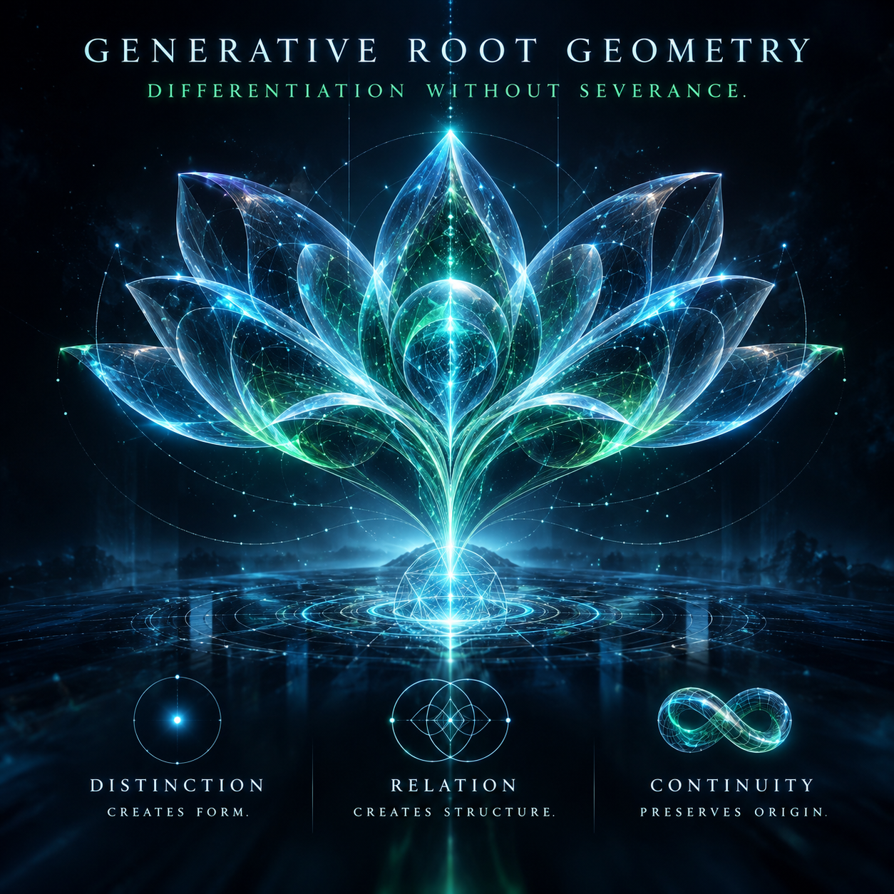

#  Generative Root Geometry

*A first-class ontological specification of differentiation, relation, and continuity: many expressions, one traceable generative structure.*

> **Differentiation without severance:** a structure may differentiate, compose, transform, and acquire new properties without losing its generative origin, provided the constitutive relationships required for that origin remain intact.



## Definition

**Generative Root Geometry (GRG)** is a substrate-independent **generative ontology and structural model** describing how a declared root makes a space of distinguishable states, relations, transformations, and manifestations possible while allowing legitimate descendants to preserve a traceable constitutive lineage through change.

The root is **constitutively prior** to the manifestations it generates; it need not be the first event in time, a physical object, or even an ordinary member of the generated state space. **Identity of origin is not identity of expression.** Two descendants may look and behave differently while retaining the same origin; two similar manifestations may have unrelated origins.

The irreducible **Root Relational Kernel** in this architecture is:

```text
K* = <DISTINCTION, RELATION, CONTINUITY>

DISTINCTION   Something becomes identifiable as distinct.
RELATION      Distinct things acquire explicit, composable structure.
CONTINUITY    Transformations preserve the relevant constitutive lineage.
```

The triad is the architecture's **declared minimal generative grammar**, not an independently proven universal law of physics. A domain must specify what counts as distinction, relation, continuity, admissible transformation, and equivalence. A valid root relationship does **not** automatically confer permission to execute a protected consequence.

## Architectural classification

| Aspect | Classification |
| --- | --- |
| Ontological concept | The structure through which differentiated descendants can arise from a common generative ground. |
| Model | **Yes.** A generative ontology and structural model. |
| Invariant | **No.** [Constitutive Continuity](../../invariants/constitutive-continuity/README.md) specifies its separately verified preservation requirement. |
| Foundational primitive | **GRG is a root-level specification**, not a single primitive; its internal kernel consists of Distinction, Relation, and Continuity. |
| Semantic type | `GenerativeGeometrySpecification`, with a separately expressible `RootContinuityInvariant`. |
| Mathematical structure | A root-relative generative transition/relation model with lineage-preservation predicates and traceable descendants. |
| Verification obligation | Establish exact operators, admissible transformations, relevant equivalence, lineage continuity, and the scope of any preservation claim. |
| Proof artifact | An independently checkable, version-bound root/lineage preservation proof for a declared model and its descendants. |
| Runtime relevance | Application to deployed computation requires verified correspondence from model transitions and relations to actual system behavior. |

```text
GENERATIVE ROOT
  Declared source of a possibility structure
    ↓
ROOT RELATIONAL KERNEL
  DISTINCTION · RELATION · CONTINUITY
    ↓
DIFFERENTIATION AND RELATION
  Distinct identities and first-class relationships
    ↓
COMPOSITION AND TRANSFORMATION
  Recursive structures and admissible trajectories
    ↓
MANIFESTATIONS
  Diverse states, behaviors, artifacts, and effects
    ↑
CONSTITUTIVE TRACEBACK
  Recover every load-bearing transformation to the Root
    ↓
ORIGIN-STANDING CLAIM
  Warranted only when the relevant lineage is established
```

The upward arrow represents **explanatory traceback**, not reversal of elapsed time. The architecture may recursively generate local roots and composite structures; the depth to which a particular claim must be traced depends on what that claim asserts.

## Formal identity

- **Identifier:** `GENERATIVE_ROOT_GEOMETRY_DIFFERENTIATION_WITHOUT_SEVERANCE`
- **Type:** `GenerativeGeometrySpecification`
- **Root kernel:** `K* = <DISTINCTION, RELATION, CONTINUITY>`

A portable GRG specification can be represented as:

```math
\mathcal{G}_R = \langle R,S,D,L,T,C,K,P,O,Q\rangle
```

| Symbol | Meaning |
| --- | --- |
| $R$ | The declared generative root or origin specification, with defined scope. |
| $S$ | States and configurations within the modeled possibility space. |
| $D$ | Differentiation operators introducing distinct identities, states, or regions. |
| $L$ | Constitutive relational structure, including relations among descendants. |
| $T$ | Admissible transformation and composition operators. |
| $C$ | Context, environment, and history relevant to a manifestation. |
| $K$ | Applicable root invariants, including the Root Relational Kernel. |
| $P$ | Actual provenance/lineage relation and its supporting evidence representation. |
| $O$ | Observation or projection from a manifestation to a visible expression. |
| $Q$ | Explanatory return/traceback operation toward the relevant origin. |

For a proposed generative path $p$:

```math
p:\quad R=s_0\xrightarrow{T_1}s_1\xrightarrow{T_2}\cdots\xrightarrow{T_n}s_n=m
```

**Root-continuous descent** is the root-relative specialization of [Constitutive Continuity](../../invariants/constitutive-continuity/README.md). Every material transformation must be admissible and preserve the declared root kernel under an independently specified correspondence.

Here, $\mathrm{RootContinuous}_R(p)$ denotes that canonical preservation condition specialized to the root $R$ and path $p$. Equivalent lineage need not imply identical state, behavior, or properties. Compositions require coverage of all material parents, not only one favorable path.

An **origin-standing claim** about $m$ additionally requires trustworthy evidence establishing the relevant path, rather than merely a claim of common ancestry:

```math
\boxed{
\mathrm{OriginStanding}(m,R)
\Leftarrow
\mathrm{Verified}\!\left(\exists p:R\leadsto m\;\land\;\mathrm{RootContinuous}_R(p)\right)
}
```

This is a sufficient warrant rule within its declared trust assumptions—not proof that all factual histories can be reconstructed. **Actual origin and our ability to prove origin are separate properties.**

## Minimal invariant kernel

The following three elements are the irreducible kernel *assumed by this architecture*, each requiring a domain-specific mechanical interpretation:

| UNIVERSAL_ID | Definition |
| --- | --- |
| `GRG_DISTINCTION` | A generated state or descendant MUST possess sufficient distinguishability to identify its relevant boundary, role, and state. |
| `GRG_RELATION` | Relevant differentiated structures MUST participate in explicitly defined constitutive relations that make composition and dependency meaningful. |
| `GRG_CONTINUITY` | Every claimed legitimate descendant MUST preserve the load-bearing constitutive relationship to its declared root throughout its generative path. |

## Operational invariant catalog

| # | UNIVERSAL_ID | Obligation |
| --- | --- | --- |
| 1 | `GRG_ROOT_IDENTITY_AND_SCOPE_ARE_EXPLICIT` | The root, its interpretation, and the domain of generated descendants MUST be unambiguously defined. |
| 2 | `GRG_DESCENDANTS_RETAIN_DISTINCT_IDENTITY` | Differentiation and composition MUST NOT silently collapse distinctions necessary for attribution or evaluation. |
| 3 | `GRG_CONSTITUTIVE_RELATIONS_ARE_EXPLICIT` | Dependence, composition, and ancestry MUST be represented by defined relations, not inferred from resemblance or adjacency. |
| 4 | `GRG_RELATIONAL_STATE_IS_PRESERVED_WHEN_MATERIAL` | State belonging to a constitutive relationship MUST NOT be silently replaced by endpoint-local state. |
| 5 | `GRG_TRANSFORMATIONS_HAVE_DEFINED_SEMANTICS` | Each admissible generative transformation MUST specify what it changes, preserves, and makes newly possible. |
| 6 | `GRG_ADMISSIBLE_DESCENT_PRESERVES_ROOT_KERNEL` | Every transformation claimed as root-continuous MUST preserve the declared kernel under an independently specified equivalence. |
| 7 | `GRG_ROOT_PROVENANCE_SURVIVES_TRANSFORMATION` | The lineage of a descendant MUST remain reconstructable to the depth required by the claim being made. |
| 8 | `GRG_COMPOSITION_PRESERVES_APPLICABLE_STRUCTURE` | Creating a higher-order whole MUST account for the identities, material relations, and continuity obligations of its constituents. |
| 9 | `GRG_ORIGIN_IDENTITY_DIFFERS_FROM_EXPRESSION_IDENTITY` | Common origin MUST NOT be treated as proof of identical local form, behavior, or properties. |
| 10 | `GRG_SURFACE_SIMILARITY_DOES_NOT_PROVE_ORIGIN` | Similar or identical observations MUST NOT substitute for verified generative lineage. |
| 11 | `GRG_EMERGENT_PROPERTIES_HAVE_DEFINED_GENESIS` | Claims about a property MUST identify or justify the layer at which the property is constituted. |
| 12 | `GRG_ORIGIN_STANDING_DOES_NOT_IMPLY_PROPERTY_STANDING` | Establishing common ancestry MUST NOT automatically attribute every descendant property to the root. |
| 13 | `GRG_TRACEBACK_PRESERVES_LOAD_BEARING_TRANSFORMS` | Foundational inference MUST account for every transformation material to the claimed property's genesis. |
| 14 | `GRG_UNRESOLVED_LINEAGE_REMAINS_UNRESOLVED` | Insufficient provenance MUST NOT be converted into confirmed common origin or proven structural severance. |
| 15 | `GRG_GOVERNED_DESCENT_PRESERVES_INHERITED_OBLIGATIONS` | **When governance is instantiated**, descendant models MUST preserve applicable parent law or declare unresolved semantic residuals and block unsupported promotion. |
| 16 | `GRG_GOVERNED_ROOT_CHANGE_REQUIRES_PRIOR_AUTHORITY` | **When governance is instantiated**, a descendant MUST NOT unilaterally change the root conditions granting its own authority. |
| 17 | `GRG_RUNTIME_CLAIMS_REQUIRE_MODEL_CORRESPONDENCE` | **When claiming implementation-level preservation**, actual execution and effect-producing transitions MUST be shown to conform to the verified generative model. |

Obligations 1–14 describe root/lineage modeling and inference; obligations 15–17 apply when GRG is used as a governed, executable constitution. No declaration, stable name, digest, or signature constitutes proof of the modeled relationship on its own.

## Semantic type and proof artifact

```csharp
// Copyright 2026 Beau Crawford
// SPDX-License-Identifier: Apache-2.0

// Conceptual semantic object; constructing it does not prove preservation.
public sealed class GenerativeRootGeometry<TState, TRelation>
    : GenerativeGeometrySpecification<TState, TRelation>
{
}
```

A GRG claim describes a root identity and scope; distinguishable entity and state types; the relational model; differentiation, transformation, and composition rules; kernel-preservation semantics; context/history; and claim-specific provenance obligations.

A separate **Root Continuity Proof** binds a particular descendant or descendant class to exact versions of the root, its admissible transformations, the applicable equivalence relations, and independently checkable lineage evidence. Proving one descendant does not prove arbitrary descendant classes; proving a specification does not prove deployment behavior.

For a governed instantiation, root publication, delegation, semantic descent, and effect authority require **additional verification mechanisms**. Root provenance establishes where a structure came from; it does not, by itself, establish current authority to perform a protected effect.

## Relationship to Governing Root Geometry

The canonical [Governing Root Geometry model](../governing-root-geometry/README.md) defines its constitutive sources, jurisdiction, delegation, applicability, and amendment obligations.

**Generative Root Geometry** is the underlying *structural grammar of becoming*. **Governing Root Geometry** is an authoritative, domain-scoped semantic constitution *instantiated using that grammar* and independently established by a legitimate publisher or trust root.

| Dimension | Generative Root Geometry | Governing Root Geometry |
| --- | --- | --- |
| Primary question | How can differentiated structures emerge without losing generative continuity? | Which exact states, transitions, and effects have governing authority? |
| Primary elements | Distinction, Relation, Continuity; generative operators; lineage. | Authorized ontology, invariants, constraints, effect semantics, versions, and promotion rules. |
| Inherent authorization | **None.** Generative descent does not grant consequence authority. | Authority depends on independently verified publication, delegation, standing, and custody. |
| Proof requirement | Preserve and establish the relevant generative relationship. | Establish governing validity, semantic conformance, and protected-effect control. |

The transition from a general generative root to an authoritative constitution is **not automatic**. It requires independently constituted governance rules, trusted publication, and an explicit binding from those rules to consequences.

## Relationship to Structural Standing and the Zero invariants

| Concept | Architectural role | Difference from GRG |
| --- | --- | --- |
| **Generative Root Geometry** | Specifies differentiation, relation, and preservation of origin. | Provides structural vocabulary; does not itself adjudicate or enforce effects. |
| **Structural Standing** | Ensures every covered enabled protected effect actually satisfies governing eligibility and support obligations. | Depends on a domain-specific contract and real enforcement, not just root lineage. |
| **Topological Zero** | Establishes that no in-scope path to a protected effect escapes independently governed mediation. | A capability-path coverage invariant, not a law of generative ancestry. |
| **Structural Zero** | Establishes that a specified effect is unreachable across all covered continuations within a declared horizon. | An outcome-reachability invariant; its cause may be governance, outage, or other constraints. |
| [Constitutive Authority Closure](../../invariants/constitutive-authority-closure/README.md) | Binds authentic governing law, legitimate standing, semantic conformance, and actual effect custody end to end. | A stronger consequence assurance; GRG alone cannot supply its authority or enforcement proof. |

### Composition — from generative lineage to governed consequence

```text
GENERATIVE ROOT GEOMETRY
  Establish the grammar of distinction, relation, and continuity
       ↓  explicit governing instantiation
GOVERNING ROOT GEOMETRY
  Independently authorized, exact semantic obligations
       ↓  independently verified standing and semantic conformance
STRUCTURAL STANDING
  Eligibility/support necessary at every covered effect boundary
       +
TOPOLOGICAL ZERO
  Every in-scope effect path necessarily mediated
       ↓  with sound current enforcement and complete coverage
STRUCTURAL ZERO FOR UNAUTHORIZED EFFECTS
  No covered continuation can produce an ineligible consequence
       ↓  with verified actual effects and evidence
CONSTITUTIVE AUTHORITY CLOSURE
  Law, authorization, execution, and consequence remain bound
```

This diagram is **a dependency/assurance composition, not an automatic logical implication**. It additionally requires accurate scope, model-to-deployment correspondence, trustworthy sources, independent checks, and non-bypassable effect custody. Legitimately authorized consequences may remain reachable.

## Essential distinctions

[Constitutive Agent Identity](../constitutive-agent-identity/README.md) specializes distinction, relation, and continuity for governed computational agents. Its same-identity claims require [Identity Continuity](../../invariants/identity-continuity/README.md); general root continuity alone does not establish them.

| Claim | What it establishes—and what it does not |
| --- | --- |
| `DISTINCTION` | Descendants can be identified separately; difference does not itself establish severance. |
| `RELATION` | Their connection carries defined structure; adjacency alone does not prove provenance. |
| `CONTINUITY` | Relevant generative obligations persist; it does not imply identity of expression. |
| `ORIGIN_STANDING` | Sufficiently warranted ancestry to a declared root; it does not imply execution permission. |
| `PROPERTY_STANDING` | Warrant to attribute a particular property to a particular constitutive layer. |
| `SEMANTIC_DESCENT` | Progressive specialization of inherited meaning; residuals and fidelity need checking. |
| `PROTECTED_EFFECT_STANDING` | Current permission for a specific consequence under independently governed rules, beyond GRG lineage. |

**Three common inference errors** must remain separate: observing similar outcomes does not prove common origin; proving origin does not prove inherited properties; and proving origin does not authorize consequences. An unknown lineage is **unresolved**, not automatically false or true.

## Examples

| Situation | GRG conclusion | Additional obligation |
| --- | --- | --- |
| Two agents share the same signed root but have different tools and behaviors | Different expressions can preserve a common origin. | Verify each agent's formation lineage and material kernel preservation; signatures alone are insufficient. |
| A child state space specializes the parent and introduces a new domain relation | Differentiation can increase expressiveness without severance. | Check inherited obligations, declared semantic mappings, and unresolved residuals. |
| Two programs produce identical outputs | Similarity alone says nothing conclusive about common origin. | Check source-to-artifact provenance before claiming shared lineage. |
| A descendant has a valid lineage but attempts an unauthorized protected write | Origin continuity may hold while consequential standing does not. | Independent admission, Structural Standing, and effect custody are still required. |
| A new root changes what descendants are permitted to do | A new generative version can define a different possibility structure. | In a governed system, promotion/rebinding must be independently authorized under previously applicable rules. |

## Scope and limits

GRG is a **portable structural framework**, not evidence that one universal physical root exists or that all domains instantiate identical dynamics. Quantum, Taoist, biological, and physical parallels are analogies or proposed instantiations, not proofs of a universal empirical law.

The three-part kernel is **minimal by the chosen architecture's modeling commitments**; formal independence, unique minimality, completeness, and physical universality would each require separate arguments. Proofs must specify a real model and assumptions. An implementation's correctness, signature validity, and effect custody must never be silently inferred from the generative description.

## Governing principle

> **Differentiation without severance: a thing may become radically different in form without becoming generatively orphaned, provided its relevant constitutive lineage remains intact.**

**Distinction permits variation. Relation permits composition. Continuity preserves the path back to origin.**

**Generation moves outward. Understanding traces inward. Neither ancestry nor appearance can authorize consequence without an independently established governing boundary.**

---

© 2026 Beau Crawford
