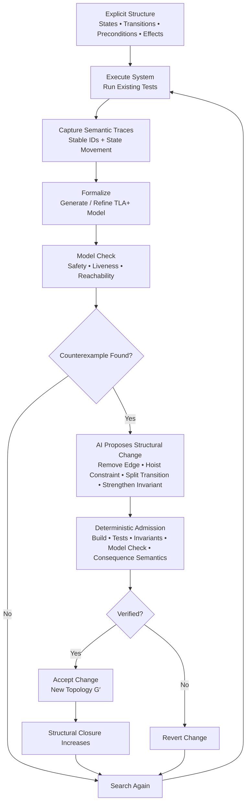

#  Verified Closure Flywheel — Diagram

> **AI searches. Verification admits. Closure compounds.**

The **Verified Closure Flywheel** is a closed-loop engineering pattern for progressively reducing invalid consequential reachability while preserving required valid behavior.

The system makes its structure observable, executes known behavior, captures semantic traces, formalizes the reachable state space, searches for counterexamples, and uses AI to propose structural improvements.

AI may search.

AI may propose.

**AI does not decide what survives.**

Every proposed change must cross a deterministic verification boundary before it becomes authoritative.

---

## Flywheel



---

## Process

| Step | Stage | Input | Operation | Output | Governing Principle |
|---:|---|---|---|---|---|
| **1** | **Expose Structure** | Source / model | Assign stable IDs to states, transitions, preconditions, invariants, effects, and consequences | Explicit consequential structure | **Make topology observable** |
| **2** | **Execute** | Structure + tests | Run existing scenarios and tests | Runtime behavior | **Exercise known trajectories** |
| **3** | **Trace** | Executions | Record state, transition, condition, effect, and consequence movement | Semantic traces | **Observed executions become witnesses** |
| **4** | **Formalize** | Structure + traces + invariants | Generate or refine a TLA+ specification | Formal state-space model | **Model possibility, not just examples** |
| **5** | **Model Check** | Formal model | Search safety, liveness, reachability, and temporal properties | Proof result / counterexample | **Search the reachable universe** |
| **6** | **Diagnose** | Counterexample | Determine why invalid movement remains reachable | Structural defect | **Ask why the path exists** |
| **7** | **Propose** | Structural defect | AI proposes a topology change | Candidate rewrite | **Probabilistic discovery** |
| **8** | **Verify** | Candidate rewrite | Build, test, check invariants, model-check, and preserve consequence semantics | Accept / reject decision | **Deterministic admission** |
| **9** | **Accept or Revert** | Verification result | Retain only mechanically admissible changes | New verified topology or original restored | **No proposal self-authorizes** |
| **10** | **Repeat** | Updated topology | Re-run the loop | Progressive structural closure | **Closure compounds** |

---

## Acceptance Invariant

A proposed structural change should be admitted only when required legitimate behavior is preserved while invalid reachability does not increase.

```text
VALID REACHABILITY'
=
VALID REACHABILITY

INVALID REACHABILITY'
⊆
INVALID REACHABILITY

INVARIANTS'
=
TRUE

CONSEQUENCE SEMANTICS'
=
CONSEQUENCE SEMANTICS
```

In plain thought:

> **The system may become structurally smaller, but it may not become semantically poorer.**

A change must not obtain apparent safety by accidentally removing behavior that the system is required to support.

---

## Closed-Loop Geometry

```text
STRUCTURE
→ EXECUTE
→ TRACE
→ FORMALIZE
→ MODEL CHECK
→ COUNTEREXAMPLE
→ AI PROPOSES STRUCTURAL CHANGE
→ DETERMINISTIC VERIFICATION
→ ACCEPT / REVERT
→ REPEAT
```

The purpose of the loop is not merely to make failing tests pass.

The stronger question is:

> **What structural change would make the invalid trajectory impossible?**

That shifts the engineering objective from repairing observed failures to progressively reducing the invalid portion of the reachable state space.

---

## Authority Separation

The flywheel deliberately separates **discovery authority** from **admission authority**.

```text
AI
→ SEARCHES

FORMAL METHODS
→ EXPOSE COUNTEREXAMPLES

AI
→ PROPOSES CHANGES

DETERMINISTIC VERIFICATION
→ DECIDES WHAT SURVIVES
```

This separation is essential.

AI may be probabilistic, creative, exploratory, and aggressive in searching for a tighter structure.

The promotion boundary should not be.

> **Probabilistic discovery. Deterministic admission. Monotonic structural closure.**

---

## Convergence

Repeated successful iterations produce a sequence of verified topologies:

```text
G₀
→ G₁
→ G₂
→ G₃
→ ...
→ G*
```

Each accepted topology should preserve required legitimate reachability while removing or constraining avoidable invalid consequential reachability.

The convergence target is not **zero behavior**.

It is:

> **The smallest verified consequential topology that preserves all required legitimate behavior while eliminating every safely removable invalid path.**

---

## Maximum Compression

```text
OBSERVE STRUCTURE
→ SEARCH POSSIBILITY
→ FIND COUNTEREXAMPLE
→ PROPOSE REDUCTION
→ VERIFY
→ ACCEPT OR REVERT
→ REPEAT
```

**AI searches.  
Verification admits.  
Closure compounds.**

---

© 2026 Beau Crawford
