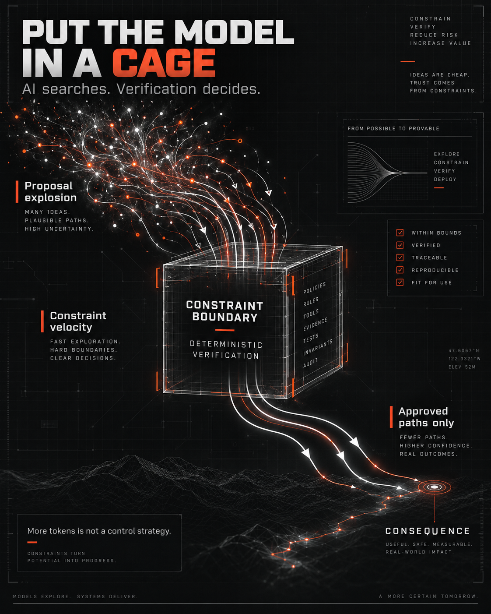

#  VERIFIED CLOSURE FLYWHEEL

**AI searches. Verification admits. Closure compounds.**



Most teams are using AI to generate more code.

A more interesting use is to make the system progressively harder to break.

The **Verified Closure Flywheel** is a closed-loop engineering process where explicit system structure, execution traces, formal verification, and AI-generated structural changes continuously feed one another.

The goal is not:

MORE CODE.

The goal is:

LESS INVALID REACHABILITY.

---

## DIAGRAM

- See: [Diagram](./Diagram.md)

## THE LOOP

```text
STRUCTURE
→ EXECUTE
→ TRACE
→ FORMALIZE
→ MODEL CHECK
→ COUNTEREXAMPLE
→ AI PROPOSES STRUCTURAL CHANGE
→ VERIFY
→ ACCEPT / REVERT
→ REPEAT
```

---

## STEP 1 — MAKE THE STRUCTURE VISIBLE

Give consequential architectural elements stable identities:

```text
STATE_ID
TRANSITION_ID
PRECONDITION_ID
INVARIANT_ID
EFFECT_ID
CONSEQUENCE_ID
```

Emit enough information to reconstruct:

```text
STATE
→ TRANSITION
→ PRECONDITIONS
→ EFFECTS
→ NEXT STATE
```

The first objective is simple:

**Make the system's consequential topology observable.**

---

## STEP 2 — RUN THE SYSTEM

Execute the tests you already have.

Capture traces showing:

```text
starting state
transition attempted
preconditions evaluated
effects executed
resulting state
consequence produced
```

Tests now produce more than PASS / FAIL.

They produce **semantic witnesses**.

---

## STEP 3 — COMBINE DECLARED STRUCTURE + OBSERVED TRACES

Do not model the system from traces alone.

Traces tell you what happened.

The transition definitions tell you what the system says may happen.

Give both to AI:

```text
DECLARED TRANSITION STRUCTURE
+
EXECUTION TRACES
+
KNOWN INVARIANTS
```

Now AI has enough context to reason about the topology rather than merely individual test failures.

---

## STEP 4 — GENERATE FORMAL PROPERTIES

Have AI propose:

```text
TLA+ safety properties
invariants
temporal properties
reachability questions
counterexample searches
```

Examples:

```text
KNOWN_INVALID
→ NEVER CONSEQUENCE

TERMINALLY_INVALID
→ NEVER ACTIVE AGAIN

CONSUMED
→ NEVER CONSUMED AGAIN

STALE_AUTHORITY
→ NEVER BIND

PROTECTED_EFFECT
→ ALWAYS HAS GOVERNED PATH
```

AI proposes the specification.

AI does not get to declare it correct.

---

## STEP 5 — MODEL CHECK

Run the formal model.

Search the state space.

Find the weird trajectories your authored tests never considered:

```text
unexpected interleavings
retries
resurrection
stale authority
duplicate consequence
alternate routes
invalid transitions
impossible-looking state combinations
```

A counterexample is not merely another failed test.

It is evidence that the architecture contains a reachable possibility you may not want.

---

## STEP 6 — FEED COUNTEREXAMPLES BACK TO AI

Now ask a different question than:

**"How do we make the test pass?"**

Ask:

**"What structural change would make this invalid trajectory impossible?"**

AI can propose:

```text
move a constraint
split a transition
remove an edge
add a lifecycle state
strengthen a precondition
change transition cardinality
bind identity differently
stage an effect
make consequence atomic
```

That is architectural search.

---

## STEP 7 — DETERMINISTIC ADMISSION

AI may propose the change.

AI does not approve the change.

The candidate must survive:

```text
BUILD
+
EXISTING TESTS
+
VALID TRAJECTORY TESTS
+
INVARIANTS
+
MODEL CHECKING
+
CONSEQUENCE SEMANTICS
```

The acceptance target is:

```text
VALID REACHABILITY'
=
VALID REACHABILITY
```

while:

```text
INVALID REACHABILITY'
⊆
INVALID REACHABILITY
```

and:

```text
INVARIANTS' = TRUE
```

and:

```text
CONSEQUENCE SEMANTICS'
=
CONSEQUENCE SEMANTICS
```

In plain thought:

**Do not make the system safer by accidentally deleting something legitimate.**

---

## STEP 8 — KEEP OR REVERT

```text
VERIFIED?
   ↓
YES → KEEP

NO  → REVERT
```

Every retained change should leave the system at least as capable of legitimate consequence and no more capable of invalid consequence.

That is the ratchet.

---

## STEP 9 — REPEAT

Run the system again.

Capture new traces.

Regenerate or refine the model.

Search again.

Find the next counterexample.

Propose the next structural reduction.

Verify again.

```text
G₀
→ G₁
→ G₂
→ G₃
→ ...
→ G*
```

Each accepted iteration attempts to reduce avoidable invalid consequential reachability.

---

## THE DESTINATION

Eventually the nature of the work changes.

Early iterations find obvious failures.

Later iterations find increasingly subtle topology:

```text
composition
concurrency
delegation
alternate paths
intermediate effects
temporal conditions
external dependencies
residual uncertainty
```

The system begins converging toward a point where another structural reduction cannot be made safely without eliminating legitimate behavior.

That is movement toward **Structural Closure**.

---

## THE IMPORTANT SEPARATION

```text
AI
→ SEARCHES

FORMAL METHODS
→ FIND COUNTEREXAMPLES

AI
→ PROPOSES REPAIRS

DETERMINISTIC VERIFICATION
→ DECIDES WHAT SURVIVES
```

Never reverse that authority relationship.

The AI can be creative.

The admission boundary should not be.

---

## THE PRINCIPLE

**Probabilistic discovery.  
Deterministic admission.  
Monotonic structural closure.**

Or even simpler:

**AI searches.  
Verification admits.  
Closure compounds.**

Don't use AI just to generate more code.

Use it to continuously search for a **smaller invalid reachable universe**.

---

## REFERENCES

- [TLA+ home page — Leslie Lamport](https://lamport.azurewebsites.net/tla/tla.html) — Primary-source overview, learning resources, and links to the TLC model checker and TLAPS proof system.

---

© 2026 Beau Crawford
